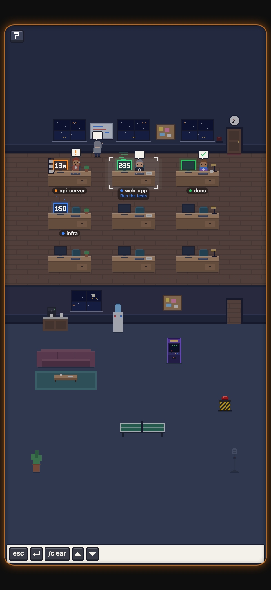
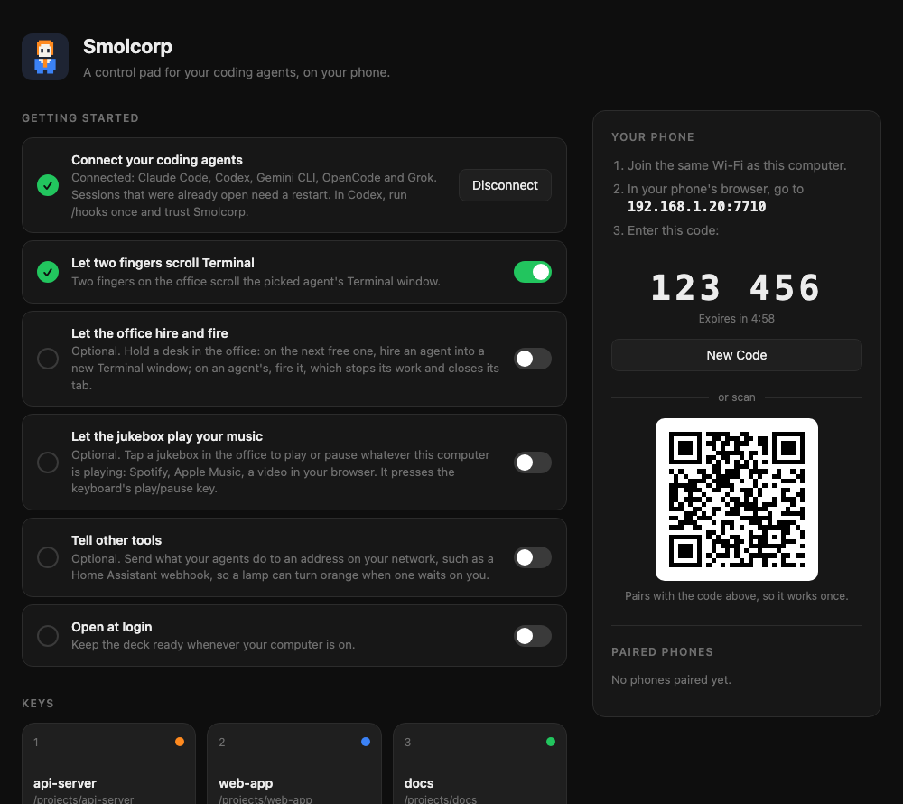
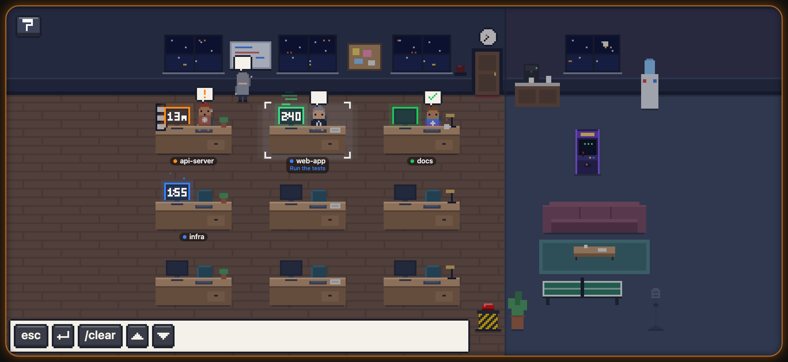
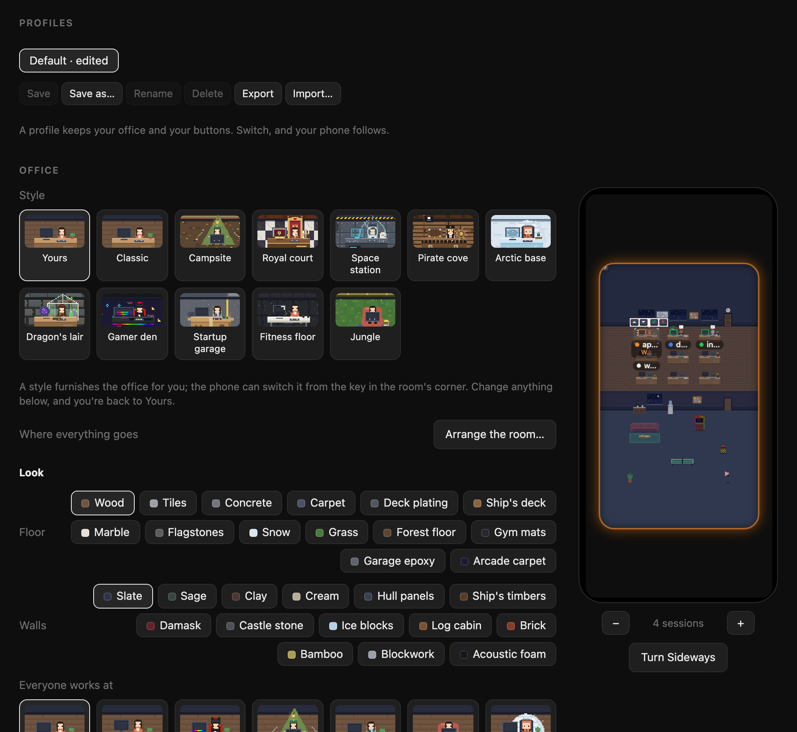

<picture>
  <source media="(prefers-color-scheme: dark)" srcset="docs/logo-dark.svg">
  
</picture>

# Smolcorp

[](https://github.com/Sauzze/smolcorp/actions/workflows/ci.yml)

<p align="center">
  
</p>

A control pad on your phone for the AI coding agents in your terminal: Claude
Code, Codex, Gemini CLI, OpenCode and Grok.

Your agent sessions are people in [a little pixel-art office](#the-office) on
your phone, each at a desk, acting out what it's doing. From the office you can
approve a permission request from across the room, interrupt an agent, change
how hard Claude thinks, press buttons of your own, or hold the mic and talk to
it. Smolcorp runs in
your Mac's menu bar, or in the tray on [Windows and Linux](#windows-and-linux-preview).
Your phone connects to it over your Wi-Fi, so there's nothing to install from
an app store.

And it's not only one agent at a time: it's [a small company](#run-a-team).
Hold an empty desk to hire a Reviewer, a Tester, a Bug hunter or a role of your
own, and put a manager at the middle desk to brief the others and check on
their work, while you watch the whole team from your phone.

Smolcorp was called SauzzeDeck Pro up to version 1.6.1, and AgentDeck up to 1.0.1.

<p align="center">
  
</p>

> Smolcorp is an independent project. It is not made by or affiliated with Anthropic.

## On your phone

The phone opens straight into the office, full screen, upright or sideways as
you hold it. Each desk is one of your agent sessions, named after its project:
the folder the agent started in, or the top of its git repository.

| In the office | What it does |
|---|---|
| **A desk, or its person** | Picks that session and brings its Terminal window to the front. |
| **▲ ▼ ✓ ✕ over the picked agent, when it's waiting on you** | Move through its options, accept or reject. They come up on their own. |
| **A desk, held** | Brings out its keys along the foot of the room: **esc** interrupts it, **⏎ send** presses Return, **/clear** starts a fresh conversation (tap twice), **↑ ↓** move through its menus, then [your own buttons](#make-it-yours). On a Claude Code desk, also paint chips for its thinking effort, from low to max; if Claude is mid-task, the change waits until it finishes. The coffee by the monitor shows the effort: one mug for low, up to four, and a steaming pot at max. A tap elsewhere puts them away. |
| **The red button** | ☢ Max effort for the picked session, in one press. |
| **The mic, held** | Talk to Claude Code. Let go, and Claude sends what you said once it's three words or more. |
| **Two fingers, dragged** | Scroll the picked session's Terminal window; tap with two to jump back to the bottom. Off until you turn on **Let two fingers scroll Terminal** on the setup page. |

How the people show what their sessions are doing is under
[The office](#the-office). The room's edge glows while an agent is waiting on
you.

Sessions keep their order at the desks; with a fixed number of desks, each
keeps its own until it ends. You can pin projects to specific desks and
furnish the office your way.

## Run a team

The office has up to nine desks, so you can run it like a small company.

**Hire by role.** Hold the desk a new hire would take, and pick who to hire:
a **Reviewer**, a **Tester**, a **Bug hunter**, a **Docs writer**, a
**Refactorer**, thirteen more from an Art Director to a Chef, or one of up to
twelve roles of your own. Each role has its own instructions, agent, model and
effort, and comes in wearing its badge, like the Reviewer's glasses and red pen,
and many dress for the job. A role never guesses what to work on: its first
reply asks you which project, and its own questions, such as which branch to
review. Hiring from the office needs the Mac app for now; on Windows and Linux,
`smolcorp run --role reviewer` starts one from any terminal.
[More about roles](#the-office).

**Add a manager.** Give one session the job of running the others: opening
new sessions, briefing them, checking on them every few minutes, passing your
decisions along, and asking a second agent to review the first one's work. It
works through whatever your agent can do from a terminal; recent versions of
Claude Code can also list the other sessions on your computer and message
them directly. Smolcorp doesn't do the managing. It puts the whole team in
one room, so you see at a glance who's working, who's waiting for you and who's
done, and you answer any of them from your phone.

To set one up:

1. Start the manager in your projects folder. On the setup page, set
   [Desks](#make-it-yours) to 9 and drag the manager onto the middle desk, so
   it sits among the team.
2. Tell it its job, for example:

   > You're the manager of this team. For each task I give you, open a new
   > session in the right folder, brief it, and check on everyone every ten
   > minutes. Have a second agent review any change before it's merged. Ask me
   > before anything is pushed, released or deleted, and tell me when
   > something needs me.

3. Give it the work, and hire the rest of the team from the office.

**Agents without a terminal work upstairs.** A manager, or a script of your
own, can run Claude Code without a terminal, as `claude -p` does. Started with
`SMOLCORP_HEADLESS=1` in its environment, such a run gets a desk on the second
floor, away from your keys: take the elevator by the entrance to see it. There's
nothing to press there, as there's no terminal to type into. Set
`SMOLCORP_PARENT_FOLDER` to the folder of whoever started it, and holding its
desk says who hired it, what it's doing and for how long; tap the hirer to go
down to their desk. A run that ends, or stops being heard from, leaves.

```sh
SMOLCORP_HEADLESS=1 SMOLCORP_PARENT_FOLDER="$PWD" claude -p "Write the changelog for this release"
```

## Supported agents

Each agent tells Smolcorp what it's doing through its own hooks, and the
deck presses that agent's own keys:

| Agent | Interrupt | Fresh conversation | Effort and mic |
|---|---|---|---|
| [Claude Code](https://claude.com/claude-code) | Esc | `/clear` | ✓ |
| [Codex](https://github.com/openai/codex) | Esc | `/new` | – |
| [Gemini CLI](https://github.com/google-gemini/gemini-cli) | Esc | `/clear` | – |
| [OpenCode](https://opencode.ai) | Esc, twice | `/new` | – |
| [Grok](https://github.com/xai-org/grok-build) | Ctrl+C | `/new` | – |

The effort chips, the red button and the mic drive Claude Code's own `/effort`
and `/voice`, so they do nothing when another agent is picked. In Grok, ✕ declines with
Ctrl+C, the key Grok uses to cancel a request.

**Codex** asks you to approve new hooks before it runs them: after connecting,
run `/hooks` in Codex once and trust Smolcorp's. Codex runs its hooks in
a background service rather than in your tab, so the deck finds each Codex
session's tab by its project folder.

**OpenCode** 1 and 2 both work. OpenCode 2 runs its plugins in a background
service of its own, so the deck finds each OpenCode session's tab by its
project folder, as it does for Codex; with `opencode --standalone`, they run
in your tab and it's found at once. Either way, run one OpenCode per project
folder for the deck to tell them apart.

## Terminals

Smolcorp follows sessions in any terminal on your Mac, and drives these:

| Terminal | Keys and mic | Needs |
|---|---|---|
| **Terminal** | ✓, also behind other windows and while the Mac is locked | Accessibility |
| **iTerm2** | ✓ | Allow Smolcorp to control iTerm when macOS asks |
| **Ghostty** 1.4 or later | ✓ | Allow Smolcorp to control Ghostty when macOS asks |
| **tmux**, in any terminal | ✓ | nothing |
| **WezTerm** | ✓ | nothing |
| **kitty** | ✓ | `allow_remote_control socket-only` and `listen_on unix:/tmp/kitty` in kitty.conf |

Keys, the mic and typed commands reach the agent without bringing its window
forward, so the phone works while you're in another app, under the screen
saver and with the Mac locked. In iTerm2, Ghostty, tmux, WezTerm and kitty
that needs no Accessibility at all.

- **Ghostty 1.3** can't tell Smolcorp which window a session is in, so its
  desks show what the agent is doing, without the controls. Update to 1.4, or
  run the agent inside tmux.
- **Other terminals** (VS Code, Cursor, Alacritty, Warp): their sessions get a
  desk that shows what they're doing, with no controls. To control one of
  these agents, run it inside tmux.
- **Hiring** opens new hires in Terminal, iTerm2 or Ghostty, as you choose on
  the setup page, and with **Start inside tmux**, in a tmux session of their own.

## What you need

- A Mac running macOS 13 or later. On Windows or Linux, see
  [Windows and Linux](#windows-and-linux-preview).
- One or more of the [supported agents](#supported-agents), running in
  Terminal, iTerm2, Ghostty, WezTerm or kitty, or in tmux inside any terminal
  (see [Terminals](#terminals)). Sessions in other terminals (VS Code,
  Alacritty, Warp…) show on the deck, but can't be controlled from it.
- A phone on the same Wi-Fi as your Mac

## Install

Smolcorp is in **alpha**. It works day to day, but it isn't signed with an
Apple Developer ID or notarised yet, so macOS warns you before it opens it
the first time, and again after each update. The steps below get past that
warning; they're needed until a signed release.

There are three ways. All give you the same app.

### Download the app

1. Download **Smolcorp.dmg** from the
   [latest release](https://github.com/Sauzze/smolcorp/releases/latest) and open it.
2. In the window that opens, drag **Smolcorp** onto the **Applications**
   folder beside it. Then open Smolcorp from your Applications folder, and
   eject the **Smolcorp** disk in Finder's sidebar.
3. macOS says *"Smolcorp" Not Opened*, as Apple can't check it for
   malicious software. Click **Done**. Then:
   1. Open **System Settings → Privacy & Security** and scroll down to
      *Security*, where it says Smolcorp was blocked.
   2. Click **Open Anyway**, and confirm with your password or Touch ID.
   3. Open Smolcorp again, and click **Open Anyway** in the dialog.

   You do this the first time, and after each update.

The release also has **Smolcorp.zip**, the same app in a zip: open it and
drag **Smolcorp** into your Applications folder.

To check that your download is the one that was published, run
`shasum -a 256 Smolcorp.dmg` (or `Smolcorp.zip`) in Terminal and compare the
result with the SHA-256 in the release notes.

Updating from SauzzeDeck Pro? Quit it, delete **SauzzeDeck Pro** from
Applications and install as above. Your settings and paired phones carry over;
turn the app back on under Accessibility (see [Set up](#set-up)), and add the
deck to your phone's Home Screen again for the new name and icon.

Updating from AgentDeck? Quit it, delete **AgentDeck** from Applications and
install as above. Your settings carry over, but pair your phone again, add it
to your Home Screen again, and turn the app back on under Accessibility.

### Or with Homebrew

```sh
brew install --cask sauzze/tap/smolcorp
```

Update with `brew upgrade --cask smolcorp`. The first time it opens, and after
each update, macOS asks as above: follow step 3.

### Or build it yourself

You need Apple's free developer tools. The installer offers to install them if
you don't have them. A copy you build yourself opens without the warning.

```bash
git clone https://github.com/Sauzze/smolcorp.git
cd smolcorp
./install.sh
```

This builds Smolcorp, puts it in your Applications folder and opens it.
It also replaces an older copy named SauzzeDeck Pro or AgentDeck.

Either way, you'll see a little person in a suit in the menu bar, and the setup page
opens in your browser.

## Set up

The setup page walks you through these steps:

<p align="center">
  
</p>

1. **Connect your coding agents.** This lets every supported agent on your Mac
   tell Smolcorp what it's doing. Restart any sessions that were already
   open. Install another agent later? Click **Connect** again.
2. **Allow Smolcorp to use your keyboard.** System Settings opens. Turn
   on **Smolcorp** in the list. The buttons, the mic and scrolling need
   this.
3. **Let two fingers scroll Terminal** (optional). Drag two fingers on the
   office to scroll the picked session's Terminal window.
4. **Let the office hire and fire** (optional). Lets you start and stop agents
   from [the office](#the-office): choose the folder new hires start in, and
   which agent they are.
5. **Let the jukebox play your music** (optional). Tap a jukebox in the
   office to play or pause whatever your Mac is playing: Spotify, Apple
   Music, a video in your browser. It presses the keyboard's play/pause key.
6. **Open at login** (optional). Keeps the deck ready whenever your Mac is on.

Under **More**, at the foot of the page: [Tell other tools](#tell-other-tools),
for sending what your agents do to Home Assistant or another tool of yours.

The first time you press a button, macOS asks whether Smolcorp may
control Terminal. Click **Allow**.

## Pair your phone

1. On your computer, click the Smolcorp icon in the menu bar or tray and
   choose **Pair a Phone…**. The setup page opens with a six-digit code and a
   QR code.
2. Scan the QR code with your phone's camera. Or open your phone's browser, go
   to the address shown with the code (for example `192.168.1.20:7710`) and
   type the code.
3. Add the deck to your Home Screen: on an iPhone, tap **Share → Add to Home
   Screen**; on Android, open the browser's menu and tap **Add to Home
   screen**. Smolcorp now opens full screen and stays paired.

While the deck is open, your phone's screen stays on, from your first tap. If
an agent has been waiting on you for five minutes, the deck reminds you once,
with a chime, and a buzz on phones that allow it.

Each phone you pair appears under **Paired phones** on the setup page, with
when it was last used. **Revoke** cuts one phone off straight away;
**Unpair All Phones** does it for every phone, and is also in Smolcorp's
menu. A phone you've cut off shows the pairing page again. To use it once
more, pair it with a new code, then remove the old Home Screen icon and add
the deck again: the icon keeps the old pairing.

<p align="center">
  
</p>

## Make it yours

The setup page also has:

- **Desks.** How many desks for sessions: Auto, one per running session, or
  always 3, 6 or 9. Drag a running session onto a desk to keep that project
  there; desks you don't pin go to the next session that starts.
- **Profiles.** Save your office and your buttons under a name, and switch
  between them in a click: one for the couch, one for the desk. Default is
  always the standard office. Export a profile to back it up or share it.
  Before an imported profile is added, the setup page lists everything its
  buttons would type or press.
- **Office.** Its style, [arranging the room](#the-office), its look and its
  life, your team, the dress code, and **Your buttons**: each types a command,
  such as `/compact`, or presses a key, such as Shift+Tab to switch Claude
  Code's mode, from the keys a held desk brings out. A button can wait until
  the agent isn't busy, ask for a second tap, or be for some agents only. A
  live preview of your phone sits beside it.
- **Logo.** The Smolcorp hire or the original six keys, in the menu bar, on the
  setup page and on your phone's Home Screen. A phone picks up a new logo the
  next time you add the deck to its Home Screen.
- **More:** [Tell other tools](#tell-other-tools), for sending what your agents
  do to Home Assistant or another tool of yours.

<p align="center">
  
</p>

Open the setup page any time from the menu bar (**Open Setup…**), or by opening
Smolcorp again from Applications. A bookmark of the page won't open it: its
link carries a key that changes each time Smolcorp starts.

## The office

<p align="center">
  
</p>

Your sessions are people in a little pixel-art office. Each session is a
desk, numbered as on the setup page, and the person at it acts out what their
session is doing:

| Session | In the office |
|---|---|
| Working | Typing, the screen lit, dots rising from it |
| Waiting on you | Standing up and waving, with a blinking **!**. Kept waiting more than five minutes, they get agitated: hopping, a red **!**, steam from the ears |
| Done, unread | Leaning back with a coffee and a ✓ |
| Idle | Off to the coffee machine, the window, the water cooler, the couch or a game of ping-pong |
| Error | Head in hands, smoke from the screen. A rate limit has them waiting under the clock instead. |
| A new session, an ended one | Someone walks in through the door, or out of it |

There's more to see while they work:

- **Under each desk**, the project's name and what its agent is doing, such as
  *Editing Settings.swift* or *Waiting for you: Bash*.
- **On the monitor**, how long the turn has run. After ten minutes, the agent
  starts to sweat.
- **What they're working with.** Reading files, they leaf through papers; a
  command turns the screen terminal-green; the web spins a globe on the desk;
  a to-do list sends them to the whiteboard. Compacting the conversation, they
  feed it into a shredder.
- **Interns**, one for each of Claude Code's subagents, gather round the desk
  while they work: up to four, then a "+n".
- **What they wear** is the size of their model, the bigger the smarter: small
  models such as Haiku, GPT mini or Gemini Flash-Lite dress casual, in a
  T-shirt and jeans; medium ones such as Sonnet wear a shirt; large ones such
  as Opus or Gemini Pro a jacket; and the top ones, such as Fable, a suit and
  tie. Interns dress for their own model. While an agent's model isn't known,
  as for most agents but Claude Code, it wears its agent's colour.
- **Coffee at the desk** is Claude Code's effort: a stack of mugs by the
  monitor, one for low up to four, swaying, for extra high, and at max a
  steaming moka pot, with steam coming off the agent. Press ☢ Max, and the
  agent runs to the big red button in the corridor and slams it.
- When few sessions are running, the office's own staff hang around the lounge.

**Furnish it your way** under *Office* on the setup page:

- **A style** furnishes the whole office in one go: Classic, Campsite, Royal
  court, Space station, Pirate cove, Arctic base, Dragon's lair, Gamer den,
  Startup garage, Fitness floor, Jungle, Neon city, Submarine, Lo-fi café, Wild
  West saloon, Zen garden or Treehouse. Most bring a pet of their own: a
  fox at the Campsite, a corgi at the Royal court, a robot dog on the Space
  station, a parrot in the Pirate cove, a penguin at the Arctic base, an owl in
  the Dragon's lair, a hamster in a ball in the Gamer den, a monkey in the
  Jungle, a hover drone in Neon city, a cat in the Submarine and the Lo-fi café,
  a tumbleweed in the saloon, a snail in the Zen garden and a red panda in the
  Treehouse. Switch it from your phone too: tap the key in the room's top-left
  corner and pick one. **Yours** is the office as you furnish it below, and
  changing anything there but the pets takes you back to it. Your team, the
  daylight, the seasons and the sound stay as you set them, and so do the pets
  you pick, in place of the style's own.
- **The floor** in wood, tiles, concrete or carpet, and more, and **the walls**
  in slate, sage, clay or cream, and more.
- **In the room editor** (below): the mic you talk into, from a microphone to a
  megaphone, what hangs on the back wall, a window, a whiteboard, a pinboard,
  a poster and dozens more, with the to-do lists going up on the first
  whiteboard, the lounge's own floor and wall, and its corner piece, one of
  the lounge's pieces, each picked from its picture: an arcade
  machine, a vending machine, a foosball table, a fish tank, a bookcase and a
  beanbag, a dragon asleep on its gold, pinball, a jukebox, a pool table, a
  piano, a drum kit, a telescope, jellyfish, a bonsai, a jungle, a coffee bar,
  servers, a 3D printer, a punching bag, a treadmill, a hot tub, a ball pit or a
  campfire. Idle agents and staff go and play, grab a snack, or sit by the fire,
  and the pets join in.
- **Where everyone works:** at a desk, or a standing desk, a gaming desk, a
  tent, a cardboard box, a beanbag, an igloo, a camper van, a spaceship, a
  pirate ship, a throne or a greenhouse. Each project can have its own on its
  team card, and it goes with them when they swap desks.
- **Daylight** that follows the clock, with night falling at 8 pm, or always day.
- **Seasons in the windows:** snow in winter, with lights strung along the wall
  through December, falling leaves in autumn, blossom in spring, birds in summer.
- **Up to three pets:** a cat that naps on the couch, a dog that follows
  people about, a lizard that basks on the wall, a monkey that climbs on things
  and steals cups, or a llama, a penguin, a parrot, an owl, a capybara, a red
  panda, a corgi, a hamster in a ball, a robot dog, a bat, a snail, a fox, an
  axolotl, a black cat, a goat, a raven, a little ghost, a spider on a thread, a
  reindeer, a little snowman, a snow hare, a little cupid, lovebirds, a hover
  drone or a tumbleweed. Pick them in any style, and they take the place of its
  own.
- **In the air:** nothing, snow, floating hearts, a dragon dance or confetti,
  and **in the windows**, fireworks at night.
- **The seasons' pieces**, each its own choice in the room editor: Halloween,
  Christmas, winter, Saint Valentine, Lunar New Year, New Year's Eve and a
  sport season, a basketball court and a broadcast set, with outfits to match.
- **Sound:** off, quiet or normal, in the style of an old games console, and
  mostly silence: a burst of typing as an agent gets to work, the door, the
  coffee machine, a ping-pong rally, the red button's siren, a hire, a firing,
  the pets, the wind in winter, and now and then the lounge's piece while
  someone's at it. The one sound that asks for you is the reminder after five
  minutes of waiting. It starts with your first tap, as browsers require.
  Under it, softly, real keyboards while agents work, each at its own pace, and
  a muffled chat at a desk while a message is taken there; turn that off under
  *Typing and chatter*. The recordings are public domain (CC0), from Freesound.
- **The desks** in wood, walnut, white or black, and **the chairs** in teal,
  black, red, grey or green.
- **Office staff:** a few, none, or lots of them in the lounge.
- **A calm office**, under *Life*: nobody wanders off, the staff and pets stay
  put and nothing drifts by the windows, so the office moves only for the work,
  and draws less often, for less power. Agents still work, type, come and go.
- **A lite office on your phone**, on by default: it goes as a calm office
  does, at 30 frames a second, so the phone stays cool. It's that phone's own
  choice, and changes nothing on your other screens. To turn it off, tap the
  paint roller in the room's corner, then the switch at the foot of *Office
  style*.
- **A jukebox that plays your music**, once you turn it on under *Getting
  started*: tap any jukebox in the office to play or pause whatever this
  computer is playing, Spotify, Apple Music or a video in your browser. It
  lights up while Spotify or Apple Music plays; macOS asks once whether
  Smolcorp may ask them. Hold a jukebox for its controls: back, play or
  pause, next, and a bar for this computer's volume.

**Arrange the room** puts everything where you want it. Click **Arrange the
room…** under *Office*, and the office fills the window: click a piece to pick
it and drag it anywhere, or nudge it with the arrow keys. The lounge's pieces,
the couch, the ping-pong table, the plant, the coffee counter, the red button
and the mic grow by the handle on their corner: small, medium or large. Pick a
desk to make it what you like, a tent, a beanbag or a cardboard box, whoever
sits at it; a project's own choice on its team card still comes first.

**The drawer** beside the room holds whatever isn't in it: desks and furniture
put away, any piece the lounge can hold, up to twelve and the same one more
than once, and everything the back wall can hang, up to twelve, wherever you
slide them along it. Drag a piece into the room, or click it to put it where
it fits. To put one away, drag it onto the trash that shows below the room
while you carry it, or back to the drawer. A session whose
desk is put away waits in line along the back wall. **Start empty** leaves the
floor, the walls, the door, the mic and the red button; **Back to standard**
puts everything back; **Undo** and **Redo** (⌘Z, ⇧⌘Z) step through your
changes. The room on its side and upright are arranged on their own, and
**Copy from upright** or **Copy from sideways** starts one from the other.
People walk round whatever is in their way, and a desk nobody can get to from
the door is outlined in red. Your phone follows as you go.

**Your team**, under the furnishing, has a card for each of your projects:
choose its agent's skin, hair and hairstyle, something extra (glasses,
sunglasses, headphones, a cap, a beanie, a beard, a moustache or a bow), an
outfit and its colour, what's on their desk, where they work, and a nickname
for their desk's label. Anything left on Auto stays as the office picks it, and clothes on Auto
follow the model.

**The dress code**, under the team, chooses the outfit and colour for each size
of model, and for each agent while its model isn't known. Add your own rules
for models the office doesn't know, such as "a model whose name contains
`qwen-max` is large". Thirteen outfits to choose from, there and on the team
cards, from a T-shirt to a lab coat, overalls or a Hawaiian shirt.

It's all kept with the layout, so each profile can have an office of its own.

**On your phone**, the office is the deck: see [On your phone](#on-your-phone).
Two more things work there:

| In the office | What it does |
|---|---|
| An agent's desk, held, then dragged | Picks the agent up, chair and all. Let go over another desk and the two swap. They stay that way: each project is pinned to its new desk, as on the setup page's *Desks*, where you can undo it. |
| A desk, held | With hiring and firing on, also **YOU'RE FIRED**, or the roles to hire on a desk a new hire would take (see below). |

**Hire and fire**, once you turn on **Let the office hire and fire** on the
setup page (it's off until you do):

- **Hold an agent's desk**, and a red **YOU'RE FIRED** comes out above its
  chips. Tap it, confirm, and its work stops and its Terminal tab closes. The
  agent packs a box and walks out. Claude Code keeps the conversation, so
  `claude --resume` can bring it back.
- **Hold the desk a new hire would take**, the next free one, and the roles
  come out along the foot of the room: **Anyone**, then each role with its
  badge. Tap one, and a new Terminal window opens in the folder you chose on
  the setup page. Anyone is a regular hire, with the agent you chose; a role
  starts its own agent, at its model and effort, on its instructions. The new
  hire walks in through the door with a coffee or a box. On a pinned project's
  empty desk, the hire starts in that project instead.
- **Comings and goings**, on the setup page: as above, with the coffee, the box
  and the packing up, or **Plain**, where people just walk in and out.

**Hire by role.** A role is a name, an agent, a model, an effort, a badge and
instructions, set under *Roles* on the setup page. Eighteen come with
Smolcorp, each reporting what it finds and asking before it changes anything:

- **Reviewer** (glasses and a red pen): reviews the changes you point it to,
  most serious problems first.
- **Tester** (a clipboard): runs the tests you pick and explains each failure.
- **Bug hunter** (a magnifying glass, dressed as a detective): looks for bugs
  where you point it, with how to reproduce each one.
- **Docs writer** (a quill and notebook, dressed as a librarian): checks the
  docs you pick against the code.
- **Refactorer** (a wrench, in a hard hat): proposes one refactor at a time,
  within the limits you give.
- And thirteen more, each dressed for the job: an **Art Director**, a
  **Lawyer** (who says it isn't legal advice), a **Therapist** for when you're
  stuck, a **Plumber** for pipelines, a **General Manager** to run the team, a
  **Janitor** for clean-ups, a **Firefighter** for outages, a **Pilot** for
  releases, a **Postman** for notifications and webhooks, an **Accountant**, a
  **Marketer**, a **Security guard** and a **Chef** for scaffolds and
  prototypes.

New roles that come with an update are added once, at the end of yours; one
you've deleted isn't brought back. Change any of them, put them in your order,
or add up to twelve of your own.
A role never assumes what to work on. Its first reply only asks you, all
together, which project to work on (at a pinned project's desk, whether it's
that one) and its own questions, such as the Reviewer's branch, base and what
matters most. It's told to read nothing and run nothing until you've
answered, then it gets to work. Each role's questions are yours to change, one per line. Its desk shows the role,
as in *Reviewer · api-server*, and its badge, and it keeps the role after
`/clear`. Roles stay on your computer, out of profiles: the phone only knows
their names and badges.

On Windows and Linux, firing closes the agent's pane in tmux, kitty and
WezTerm, and stops an agent started with `smolcorp run`. Hiring from the
office needs the Mac app, for now; `smolcorp run --role tester`, in the folder
to work in, starts a role from any terminal, and its desk shows the role.

**Held upright,** the room stands upright too: the lounge moves below the
desks, through a doorway at the end of the corridor.

**On a spare screen**, such as an old tablet, a TV or a second monitor, open the
address your phone uses with `/office` at the end. It pairs like a phone, then
shows the office alone, full screen, and can be tapped too.

**On top of your other windows:** on the computer running Smolcorp, open
`http://localhost:7710/office` in Chrome or Edge and click **POP OUT** in its
corner. The office moves into a small window that stays above everything else,
and can still be clicked. Other browsers, and the address your phone uses,
don't offer it.

**As your Mac's screen saver:** click the Smolcorp icon in the menu bar
and choose **Install Screen Saver…**. System Settings opens at Screen Saver:
choose **Smolcorp Office**, click **Options…**, and enter a code from
**Pair a Phone…**. It's listed under Paired phones as **Screen saver**. While
your Mac is idle, each display shows the office, just to watch: a key or a click
ends the screen saver as usual. When Smolcorp isn't running, or the screen
saver was unpaired, it says what to do instead. After updating Smolcorp,
choose **Install Screen Saver…** again.

On your phone, on a spare screen and in the pop-out window, the office fills a
rounded window; the screen saver fills each display edge to edge. Either way,
its edge glows while an agent is waiting on you.

## Voice

The mic button uses Claude Code's own voice input (`/voice`), in *tap* mode.
Connecting Claude Code sets that up, unless you had already set voice up
yourself. In that case, make sure `~/.claude/settings.json` contains:

```json
"voice": { "enabled": true, "mode": "tap" }
```

Voice input needs Claude Code signed in with a Claude.ai account. Claude Code
sends your audio to Anthropic to be transcribed. Smolcorp itself never
hears it.

## Portable office (beta)

See the office on your phone from anywhere, over 4G, while you're away. It's
view only: nothing on the phone can press a key or type into a session. It's
off until you launch it, and off again each time Smolcorp starts.

While it's on, Smolcorp locks a trimmed-down copy of the office on your Mac
(AES-256-GCM) and puts it on a small viewer you run on your own Vercel. The
key is only in your Mac's Keychain and in your link, after the `#`, which
browsers never send to any server, so the viewer only ever holds locked data.

### Set it up on Vercel

1. On Vercel, make a project from your fork of this repository. Set its Root
   Directory to `viewer/`, its Framework to "Other", and leave the build
   command empty.
2. Add **Upstash Redis** to it from the Vercel Marketplace (the free plan is
   enough). It adds `KV_REST_API_URL` and `KV_REST_API_TOKEN` for you.
3. On Smolcorp's setup page, under **Viewer link**, press **Make a write
   secret** and copy it. It's shown once. In the Vercel project, add it as
   the environment variable `VIEWER_WRITE_SECRET` (Production).
4. Deploy to production. Paste the production address
   (`https://office-viewer-xxxx.vercel.app`) into **Viewer address**, press
   **Save**, then **Check the viewer**. It says **Viewer ready ✓** or what's
   wrong.
5. Scan the QR code with your phone and add the page to your Home Screen.

A custom domain works too. Vercel Authentication doesn't, since the phone has
no Vercel login. To keep strangers from using up your free Upstash allowance,
add the firewall rule in [viewer/README.md](viewer/README.md), which also has
the relay's protocol, if you'd rather host the viewer elsewhere.

### Start and stop it

- **Start:** menu bar → **Going away: launch portable office**. The phone shows
  the office within a few seconds. While it's on, the menu bar icon has a small
  dot, and the menu says **Portable office: ON** with when it last sent.
- **Stop:** menu bar → **Stop portable office**, or quit Smolcorp. The viewer
  forgets the office straight away, and the phone says "Not active". It also
  stops by itself when you're back at your Mac (you unlock it, or wake it and
  use it, but not in the first two minutes, so you can launch it and then
  lock), and after 8 hours. Both can be changed on the setup page.
- **Lost your phone, or shared the link by mistake:** setup → **Rotate key…**.
  Every old link stops working for good; scan the new QR code. The link holds
  the key, so keep it to yourself: **Copy viewer link** in the menu copies it
  for this Mac only, never to your other devices.
- **Wipe the viewer** empties it of everything it holds.

### What's sent, and what never is

Sent, locked: each desk's state (working, waiting, done, failed), its agent and
effort, whether it's compacting, its subagents' kinds, its role's name, badge
and outfit, the theme, and how the room is furnished. Project names too,
unless you turn on **Hide project names**, which shows "Desk 1", "Desk 2"…
instead, upstairs too, where a run's hirer becomes the hiring desk's number.

Never: transcripts, prompts, what an agent or you wrote, dictation,
file names, folders and paths, commands, models, your buttons, session ids,
your Mac's name, addresses, phone ids, and any key or token. Your write
secret, the viewer's id and its key are kept in the Keychain, never in
`config.json`.

The viewer sees when the office is on and roughly how big it is, nothing
else. The Windows and Linux app doesn't have the portable office.

## Summaries with Claude

Away from the computer, a desk on the phone shows *what* an agent is doing,
not why. Hold a desk and tap **✨ summary**: Claude Haiku 5.5 reads the end of
that agent's Claude Code transcript and answers in a few lines what you asked,
what it's doing, whether it's waiting on you, and its last result.

It's off until you turn it on, and it uses **your own Anthropic API key**,
billed to you by Anthropic. Haiku is Anthropic's least expensive model, and a
summary is one short request.

### Turn it on

1. On the setup page, under *Getting started*, paste your API key into
   **Summaries with Claude** and click **Save key**. Make a key in the
   [Anthropic Console](https://console.anthropic.com/settings/keys).
2. Turn the switch on. A dialog says what's sent and where; it turns on only
   when you click **Turn on**.

Turn it off with the same switch, at any time. **Remove** forgets the key.

### What's sent, and where your key is kept

- **Sent, to Anthropic's API, only when you tap ✨ summary:** the end of that
  agent's transcript, at most 16,000 characters. That's:
  - your recent requests and its replies, each cut short;
  - each tool it ran, with the one file path, command or search that says
    what it did;
  - each tool's output, cut to its first line. For a file it read, that's the
    file's first line.

  Lines that look like they hold a secret (keys, tokens, passwords, private
  keys, passwords in URLs) are taken out first. The project's folder name is
  sent with it.
- **Your key** is kept by your system:
  - in the Keychain on a Mac;
  - in Credential Manager on Windows;
  - in the Secret Service (GNOME Keyring or KWallet) on Linux.

  It's never in `config.json`, the phone, the portable office or a log, and the
  setup page shows only its last four characters.
- **Limits:** a summary is kept for 30 seconds, so a second tap doesn't pay
  twice. At most 20 summaries go to Anthropic in any 10 minutes. A failed one
  is never retried by itself.

### Or, as a fallback, `ANTHROPIC_API_KEY`

**Paste your key on the setup page if you can:** it's then kept in your
system's secret store, and only Smolcorp reads it. With no key saved there,
Smolcorp uses `ANTHROPIC_API_KEY` from its own environment instead. On a Linux
computer with no secret store, this is the only way.

The ways below give the key to **every app you start** after setting it, not
just Smolcorp. On Windows and Linux they also keep it in a plain text setting
or file, so use them only where that's acceptable. An app you open from the
Dock, the Start menu or at login doesn't see what you `export` in a terminal,
so:

- **Mac:** run `launchctl setenv ANTHROPIC_API_KEY sk-ant-…`, then quit and
  reopen Smolcorp. It lasts until you restart the Mac.
- **Windows:** run `setx ANTHROPIC_API_KEY sk-ant-…` in a terminal, then
  restart Smolcorp. It's kept in your user's environment settings.
- **Linux:** add `ANTHROPIC_API_KEY=sk-ant-…` to
  `~/.config/environment.d/smolcorp.conf`, then log out and back in. It's
  kept in that file.

Smolcorp never reads a project's `.env` file, or any other file, for a key.

## Tell other tools

Smolcorp can tell another tool what your agents are doing, so a lamp
turns orange when one waits on you, or your phone buzzes when a long task is
done. Turn on **Tell other tools** under **More** on the setup page, give it an address, and
pick what to send:

| Event | When |
|---|---|
| `waiting` | An agent is waiting on you: a permission prompt or a question |
| `done` | An agent finished, and you haven't looked yet |
| `error` | A turn ended on an error, such as a rate limit |
| `working` | An agent got to work |
| `started` | A session started |
| `ended` | A session ended |

Waiting on you, done and failed are on to begin with. Each event is a `POST`
with a JSON body:

```json
{
  "event": "waiting",
  "at": "2026-10-17T20:41:07Z",
  "session": {
    "project": "api-server",
    "agent": "claude",
    "agentName": "Claude Code",
    "state": "asking",
    "previous": "thinking",
    "key": 1
  }
}
```

`key` is the number of the desk the session is at, as the setup page numbers
them from 1, or `null` if it has none. An
`error` also has an `errorKind`, as the agent named it, such as `rate_limit`
or `overloaded`. **Send a test** sends `"event": "test"` with no session. If
you set a secret, every message carries it in an `X-Smolcorp-Secret` header.

Only addresses on your own network are allowed: your computer, a `.local`
name, a name without dots or a private IP address. Tick **Allow addresses
outside your network** to send elsewhere. Messages name the project, never its
folder, and never carry prompts or anything an agent wrote.

### Home Assistant

Add an automation with a webhook trigger, then give Smolcorp the
webhook's address, such as
`http://homeassistant.local:8123/api/webhook/smolcorp-lamp`. Home Assistant
doesn't read headers, so keep the webhook id hard to guess and leave the
secret empty.

```yaml
automation:
  - alias: Desk lamp follows the agents
    triggers:
      - trigger: webhook
        webhook_id: smolcorp-lamp
        allowed_methods: [POST]
        local_only: true
    actions:
      - choose:
          - conditions: "{{ trigger.json.event == 'waiting' }}"
            sequence:
              - action: light.turn_on
                target: { entity_id: light.desk_lamp }
                data: { color_name: orange }
          - conditions: "{{ trigger.json.event == 'done' }}"
            sequence:
              - action: light.turn_on
                target: { entity_id: light.desk_lamp }
                data: { color_name: green }
          - conditions: "{{ trigger.json.event == 'error' }}"
            sequence:
              - action: light.turn_on
                target: { entity_id: light.desk_lamp }
                data: { color_name: red }
```

## Privacy and security

- **Smolcorp sends nothing off your network unless you turn it on.** It talks
  to your phone and to the coding agents on your computer. Only these, each off
  until you turn it on, go further:
  - the address you gave [Tell other tools](#tell-other-tools), which is on
    your network unless you allow otherwise;
  - the [portable office](#portable-office-beta)'s viewer, on your own Vercel,
    which only ever holds locked data;
  - Anthropic's API, with your own key, when you ask for a
    [summary](#summaries-with-claude).

  It has no accounts, no analytics and no cloud service of its own.
- **Each phone has its own key.** Every request carries a long random key that
  only that phone has. The key is never typed: pairing hands it over. Your
  computer keeps only a fingerprint of each key (a SHA-256 hash), so you can revoke one
  phone without touching the others.
- **Buttons you make type only what you set up.** A phone names a button by
  its id; the command it types, or the key it presses, comes from your
  computer. A paired phone can't send text of its own.
- **Pairing codes are short-lived.** A code exists only after you ask for one.
  It works once and expires after five minutes. Five wrong tries from one
  device lock that device out until you get a new code, and twenty wrong tries
  in all withdraw the code. The QR code holds the same one-time code, never a
  key, and disappears once the code is used.
- **The agents have a key of their own.** Their hook uses a separate
  key, read from a file only you can read, so it never shows up in the list of
  running processes. It works only from your computer, and only for reporting what
  an agent is doing. A phone's key can't pose as an agent, and the agents' key
  can't drive the deck.
- **Scrolling, hiring and firing are off until you turn them on.** Out of the
  box, a paired phone can only use the office's keys, effort chips and
  choices, and move desks around, which pins projects to desks as the setup
  page does. Even turned on, firing asks first, and only stops the agent
  itself; hiring only starts the agent you chose, or a role's, in the folder you
  chose or in a pinned project's. A role's instructions are the agent's first
  message, there to read in its Terminal window, never a command, and a role
  changes nothing about what its agent may do without asking.
- **The screen saver pairs like a phone,** and keeps its key in its own
  settings, as a phone's browser does.
- **The office says what your agents are doing in a few words.** They're made
  from a file's name, a web page's site or the description the agent gave a
  step, never from a command or a file's path.
- **Smolcorp listens on port 7710 on your network,** so your phone can
  reach it. Without a key, all another device gets is the pairing page. Its
  pages can't be shown inside other websites, and it turns away connections
  beyond a fixed limit, so a misbehaving device can't swamp it.
- **The setup page only opens on your computer, from Smolcorp's menu.** Other
  devices can't reach it, and other websites can't press its buttons. The menu
  opens it with a key that's new each time Smolcorp starts, so other programs
  on your computer, and other people signed in to it, can't use it either.
  Your own scripts can: the key is in a file only you can read, sent as the
  `X-Smolcorp-Setup-Key` header (see [Use setup from a script](#use-setup-from-a-script)).
- **Use a network you trust.** The connection is plain HTTP on your local
  network. Use Smolcorp on home or office Wi-Fi, not public hotspots.

### Use setup from a script

Everything the setup page does is an HTTP call to Smolcorp on this computer,
and your own scripts can make the same calls. Each needs the setup key, which
is new each time Smolcorp starts and kept in a file only you can read:

| | The setup key |
|---|---|
| Mac | `~/Library/Application Support/AgentDeck/setup-key` |
| Linux | `~/.config/sauzzedeck-pro/setup-key` |
| Windows | `%APPDATA%\SauzzeDeck Pro\setup-key` |

Send it as `X-Smolcorp-Setup-Key`. Calls that change something also need
`X-AgentDeck-Setup: 1`. For example, on a Mac:

```bash
key=$(cat ~/Library/Application\ Support/AgentDeck/setup-key)
curl -s -H "X-Smolcorp-Setup-Key: $key" http://localhost:7710/setup/state
curl -s -X POST -H "X-Smolcorp-Setup-Key: $key" -H "X-AgentDeck-Setup: 1" \
  http://localhost:7710/setup/pair
```

Read the key again after Smolcorp restarts.

## Troubleshooting

**The desks stay empty.** Click **Connect** on the setup page, then restart your
agent sessions. On Windows and Linux, start them with `smolcorp run`, or in
tmux, WezTerm or kitty.

**A desk has no controls.** Its session runs in a terminal Smolcorp can only
watch (see [Terminals](#terminals)), or in Ghostty 1.3. In kitty, check the
two lines in kitty.conf.

**Codex sessions don't appear.** Run `/hooks` in Codex and trust Smolcorp's
hook. Codex skips new hooks until you do.

**OpenCode sessions don't appear.** Smolcorp before 1.8.0 had a plugin OpenCode 2
can't load: open the new Smolcorp once, and it brings the plugin up to date,
which OpenCode picks up by itself. Still nothing? Two OpenCode sessions in one
project folder can't be told apart, so keep one per folder, or start them with
`opencode --standalone`, which runs the plugin in the session's own tab.

**Buttons, the mic or scrolling do nothing, or the phone says keyboard access
is off.** Turn Smolcorp on in System
Settings → Privacy & Security → Accessibility. Updating Smolcorp clears
that permission, because macOS treats each version as a new app. Click
**Open Settings** on the setup page again afterwards, and turn Smolcorp
back on.

**Two fingers don't scroll.** Turn on **Let two fingers scroll Terminal** on
the setup page.

**The phone shows the pairing page instead of the deck.** It was revoked, or
it was paired with AgentDeck 1.0. Pair it again, then add it to your Home
Screen again: see [Pair your phone](#pair-your-phone).

**The mic types a space instead of listening.** Claude's input box has to be
empty, and voice has to be in tap mode: see [Voice](#voice).

**The phone can't connect.** Check that both devices are on the same Wi-Fi.
If macOS or Windows Firewall asked whether Smolcorp may accept incoming
connections, allow it.

**The roles, or HIRE, don't come out.** Turn on **Let the office hire and fire**
on the setup page, and choose a folder for new hires. They show only on a desk
a new hire would take: the next free one, or a pinned project's. With no roles
set up, it's a single **HIRE**. Hiring from the office needs the Mac app, for
now.

**The screen saver says to open Smolcorp, or to pair again.** Make sure
Smolcorp is running. If it was unpaired, open System Settings → Screen
Saver, click **Options…** and enter a new code. After updating Smolcorp,
choose **Install Screen Saver…** again.

**"Port 7710 is in use."** Another copy of Smolcorp, or another app, is
using that port. Quit it and open Smolcorp again.

## Uninstall

1. On the setup page, click **Disconnect** next to your coding agents, and turn
   off **Open at login**.
2. Quit Smolcorp from the menu bar.
3. Delete **Smolcorp** from Applications, and the folder
   `~/Library/Application Support/AgentDeck`. It kept the app's original name.
4. If you installed the screen saver, choose another one in System Settings →
   Screen Saver, then delete **Smolcorp Office.saver** from
   `~/Library/Screen Savers`, and the files starting with
   `io.github.sauzze.agentdeck.screensaver` in
   `~/Library/Containers/com.apple.ScreenSaver.Engine.legacyScreenSaver/Data/Library/Preferences/ByHost`.

On Windows and Linux, disconnect and turn off **Open at login** the same way,
quit Smolcorp from its tray menu, then delete:

- **Linux:** `~/.local/bin/smolcorp` (and `~/.local/bin/sauzzedeck`, if you
  updated from SauzzeDeck Pro), `~/.local/share/applications/smolcorp.desktop`,
  and the folders
  `~/.local/share/smolcorp` and `~/.config/sauzzedeck-pro`. The settings folder
  kept the name the app had before.
- **Windows:** the folder you extracted, and `%APPDATA%\SauzzeDeck Pro`, which
  kept the name the app had before.

Connecting left a backup of each settings file it changed next to it, ending
in `.agentdeck.bak`: Claude Code's `~/.claude/settings.json`, Codex's
`~/.codex/hooks.json` and Gemini CLI's `~/.gemini/settings.json`. Delete them
once you no longer need them. Connecting Claude Code also turned on its voice
input, if it was off. Disconnecting leaves voice as it is: remove the `voice`
entry from `~/.claude/settings.json` if you don't want it.

## How it works

Each agent runs a small script ([`Resources/report.sh`](Resources/report.sh))
at each step of a session, through its hooks: Claude Code's
[hooks](https://code.claude.com/docs/en/hooks), and the matching settings in
Codex, Gemini CLI and Grok. OpenCode has no command hooks, so a small plugin
([`Resources/opencode-plugin.js`](Resources/opencode-plugin.js)) runs the same
script. The script tells Smolcorp what happened and which terminal tab it
happened in: a Terminal tab, an iTerm2 session, a Ghostty window, or a tmux,
WezTerm or kitty pane. Smolcorp reads each agent's events in that agent's terms,
works out each session's state and streams it to your phone. On Windows and
Linux, `smolcorp hook` does the script's job, and names the launcher, tmux
pane or terminal window instead of a Terminal tab.

On the Mac, each terminal is driven its own way: Terminal, iTerm2 and
Ghostty through their scripting, tmux, WezTerm and kitty through their own
command line tools. In Terminal:

- **Typed commands** such as `/effort` and `/clear` are typed into the tab
  through Terminal's scripting.
- **Keys** are sent to Terminal itself, after its tab is put first among
  Terminal's windows without bringing Terminal forward. **Scrolling** uses
  Terminal's own View → Line Up and Line Down, so it moves the window's view
  and the agent receives nothing; it brings the window forward, and doesn't
  work while the Mac is locked.
- **Hiring** opens a new window of the terminal you chose, in the
  folder you chose, with the agent's own command. A role's hire runs a short
  script that removes itself, then starts the role's agent with its model,
  effort and first message, each quoted for the shell. **Firing** stops the agent's
  process in its tab, only once it's sure that's the agent, then closes the
  tab.

The Mac app is plain Swift with no dependencies. The Windows and Linux app is
Go, with a handful: a tray icon, pseudo-terminals, QR codes. The phone side is
a single web page, shared by both.

```
Sources/AgentDeck/   the Mac app
ScreenSaver/         the Mac's screen saver, which shows the office
desktop/             the Windows and Linux app, file for file where they match
cmd/smolcorp/        its command: the app, the launcher and the hook
Resources/web/       the phone page, the office, the pairing page and the setup page, shared
Resources/           the Mac's hook script, and the OpenCode plugin
install.sh           build and install on a Mac
packaging/linux/     the Linux installer
scripts/             the builds, and the release downloads
docs/                screenshots for this page
```

## Windows and Linux (preview)

Smolcorp also runs on Windows and Linux, with the same phone deck, the
same pairing and the same agents. It's a preview: the Linux version is
tested, the Windows version is built but hasn't been run on a real PC yet.
Please report how it goes in [the issues](https://github.com/Sauzze/smolcorp/issues).

What's different from the Mac:

- **Start agents through Smolcorp**, in any terminal:
  `smolcorp run claude` (on Windows, `smolcorp-cli run claude`), or `codex`,
  `gemini`, `opencode` or `grok`. The
  agent runs exactly as usual, and the deck can press its keys, with no
  permission to grant. Windows and Linux have no equivalent of Terminal's
  scripting, so this is how the deck reaches a session.
- **In tmux, WezTerm or kitty**, agents started the usual way work too: the
  deck sends keys through the terminal's own commands. kitty needs its remote
  control turned on (`allow_remote_control yes` and `listen_on` in
  `kitty.conf`).
- **Tapping a desk** brings its pane forward in tmux, WezTerm and kitty. In the
  launcher it only selects the session, because the launcher can't tell which
  window it's in.
- **Two-finger scrolling** works in tmux and kitty.
- **No Accessibility step.** Nothing here needs that permission.

### Linux

Download **Smolcorp-Linux-x86_64.tar.gz** (or `-arm64`) from the
[latest release](https://github.com/Sauzze/smolcorp/releases/latest), then:

```bash
tar -xzf Smolcorp-Linux-x86_64.tar.gz
./Smolcorp-Linux-x86_64/install.sh
```

This installs it for you alone, in `~/.local`, with an entry in your app
menu. Open **Smolcorp** from the menu, or run `smolcorp`. The setup
page opens in your browser.

- On GNOME, the tray icon needs the AppIndicator extension, which Ubuntu
  includes. Without it, Smolcorp still runs: open
  `http://localhost:7710/setup#k=` followed by the key in
  `~/.config/sauzzedeck-pro/setup-key`.
- On a machine without a desktop, such as one you reach over SSH, run
  `smolcorp serve`. It prints the setup page's link as it starts. Open it
  through a tunnel: `ssh -L 7710:localhost:7710` to the machine, then the
  link in your own browser.

### Windows

1. Download **Smolcorp-Windows-x86_64.zip** (or `-arm64` for an ARM
   PC) from the [latest release](https://github.com/Sauzze/smolcorp/releases/latest),
   and extract it.
2. Open **Smolcorp.exe**. Windows SmartScreen warns about an unsigned
   app: click **More info**, then **Run anyway**.
3. When Windows Firewall asks, allow Smolcorp on private networks, so
   your phone can reach it.

To type `smolcorp-cli run claude` in a terminal, add the extracted folder to
your PATH: on Windows the command is `smolcorp-cli.exe`, beside the app's
`Smolcorp.exe`, as Windows doesn't tell their names apart by case. The setup page also shows the full command for where it is.

### Build it yourself

You need [Go](https://go.dev) 1.26 or later:

```bash
go build ./cmd/smolcorp
```

On Windows, that one program runs everything, in a console window of its
own. To build it as the downloads have it, with no console window, build
both:

```bash
go build -ldflags "-H windowsgui" -o Smolcorp.exe ./cmd/smolcorp
go build -o smolcorp-cli.exe ./cmd/smolcorp
```

`go test ./...` runs the tests, and `scripts/release-desktop.sh` builds the
downloads for both systems.

## Support the project

Smolcorp is free. If it earns a place on your desk and you'd like to say
thanks, you can send ETH, BNB or any token to this address, on Ethereum, BNB
Smart Chain or another EVM network:

```
0x7a81788cf4cbb7357dfe3d98ab85a6422aab26c7
```

Check the address after pasting it: transfers can't be reversed.

## License

[MIT](LICENSE)
