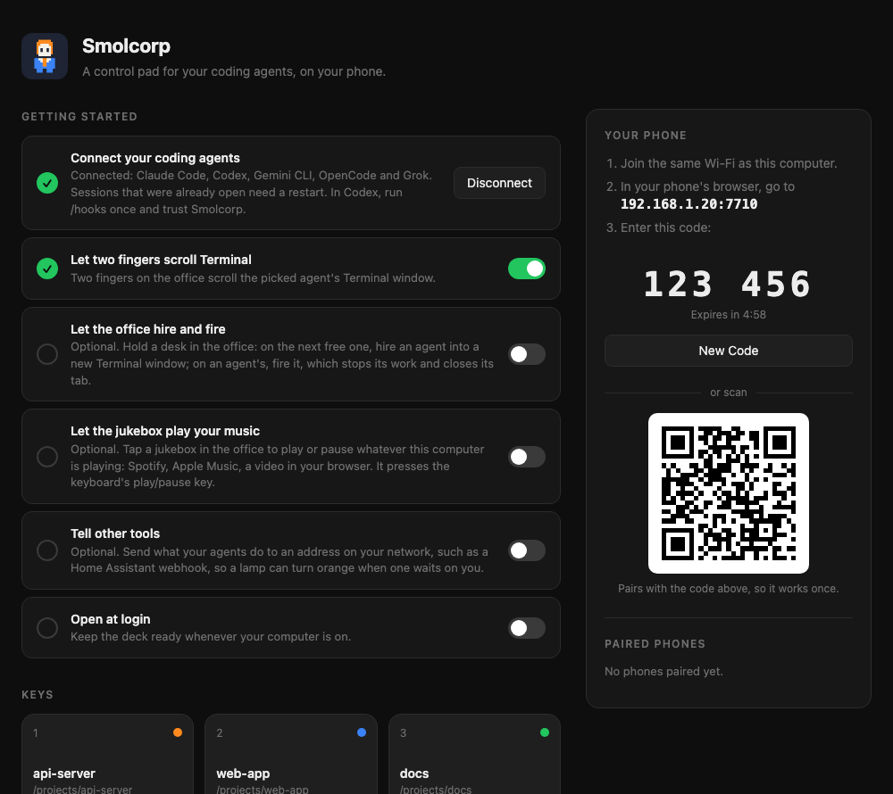

# Install and set up

What you need, every way to install Smolcorp, and the setup page's first steps. Back to the [README](../README.md).

## What you need

- A Mac running macOS 13 or later, a Windows 10 or 11 PC, or a Linux
  computer. See [Windows and Linux](windows-linux.md#windows-and-linux) for what differs.
- One or more of the [supported agents](team.md#supported-agents), running in
  Terminal, iTerm2, Ghostty, WezTerm or kitty, or in tmux inside any terminal
  (see [Terminals](team.md#terminals)). Sessions in other terminals (VS Code,
  Alacritty, Warp…) show on the deck, but can't be controlled from it.
- For the General Manager's team: [tmux](https://github.com/tmux/tmux) on a
  Mac (`brew install tmux`) or Linux, where its hires run. On Windows, the
  General Manager hires only with managed hires turned on, a beta that's off
  by default (see [The fence, and who gets it](team.md#the-fence-and-who-gets-it)).
- A phone, on the same Wi-Fi as your computer, or anywhere with
  [Tailscale](https://tailscale.com) on both.

## Install

On the Mac, Smolcorp is in **beta**, signed with a Developer ID and notarised
by Apple. On Windows and Linux it's an **alpha**,
still in testing: the Windows build isn't signed yet, so SmartScreen warns you
the first time.

**The quickest way: let your coding agent do it.** Download
[**FIRST-SETUP.md**](https://github.com/Sauzze/smolcorp/releases/latest/download/FIRST-SETUP.md) from the latest release (the Windows and Linux
downloads have it inside too). Open your coding agent (Claude Code, Codex,
Gemini CLI, OpenCode or Grok) in the folder you downloaded to, and paste what's
in that file. It installs Smolcorp,
connects your agents, checks everything, and tells you what only you can do:
an OK for Windows Firewall or macOS, and pairing your phone.

**Or from a terminal:** `smolcorp setup` on Windows (`smolcorp-cli setup`) and
Linux, `/Applications/Smolcorp.app/Contents/MacOS/AgentDeck --setup` on a Mac.
It starts Smolcorp if it isn't running, prints the checklist, and ends with 0
when nothing is in the way. It changes nothing itself: what the checklist finds
is put right on Smolcorp's setup page (Settings on a Mac).

**On Windows (alpha, in testing):** download **Smolcorp-Windows-x86_64.zip** (or `-arm64`) from the
[latest release](https://github.com/Sauzze/smolcorp/releases/latest), extract
it and open **Smolcorp.exe**. SmartScreen warns about an unsigned app: click
**More info**, then **Run anyway**. Smolcorp installs itself in
`%LOCALAPPDATA%\Smolcorp`, puts `smolcorp-cli` on your PATH, and starts from
there: the folder you extracted can go. Its setup opens on **Start here**.

**On Linux (alpha, in testing):** download **Smolcorp-Linux-x86_64.tar.gz** (or `-arm64`), then
`tar -xzf Smolcorp-Linux-x86_64.tar.gz && ./Smolcorp-Linux-x86_64/install.sh`.
If `~/.local/bin` isn't on your PATH, the installer prints the line to add
(zsh `~/.zshrc`, bash `~/.bashrc`) and changes no shell file.

**On a Mac**, three ways, all giving the same app:

### Download the app

1. Download **Smolcorp.dmg** from the
   [latest release](https://github.com/Sauzze/smolcorp/releases/latest) and open it.
2. In the window that opens, drag **Smolcorp** onto the **Applications**
   folder beside it. Then open Smolcorp from your Applications folder, and
   eject the **Smolcorp** disk in Finder's sidebar.

   The app is notarised by Apple. The first time, macOS asks whether to
   open an app downloaded from the internet: click **Open**.

   If setup then says macOS is opening a temporary copy of Smolcorp, even
   though it is in Applications, the download's mark is still on it. Smolcorp
   never removes it for you. Quit Smolcorp, run this in Terminal, and open it
   again. Then allow Accessibility.

   ```sh
   xattr -d com.apple.quarantine '/Applications/Smolcorp.app'
   ```

The release also has **Smolcorp.zip**, the same app in a zip: open it and
drag **Smolcorp** into your Applications folder.

To check that your download is the one that was published, run
`shasum -a 256 Smolcorp.dmg` (or `Smolcorp.zip`) in Terminal and compare the
result with the SHA-256 in the release notes.

To use `smolcorp` in Terminal, setup can add the command to `~/.local/bin`. If
that folder isn't on your PATH, setup shows the exact line for your shell, with
a **Copy** button: for zsh it goes in `~/.zprofile`, for bash in
`~/.bash_profile`. Smolcorp writes no shell file itself. Open a new Terminal
window after you add it.

Updating from SauzzeDeck Pro? Quit it, delete **SauzzeDeck Pro** from
Applications and install as above. Your settings and paired phones carry over;
turn the app back on under Accessibility (see [Set up](#set-up)), and add the
deck to your phone's Home Screen again for the new name and icon.

Updating from AgentDeck? Quit it, delete **AgentDeck** from Applications and
install as above. Your settings carry over, but pair your phone again, add it
to your Home Screen again, and turn the app back on under Accessibility.

### Or with Homebrew

```sh
brew install --cask sauzze/tap/smolcorp
```

Update with `brew upgrade --cask smolcorp`.

### Or build it yourself

You need Apple's free developer tools, and [Go](https://go.dev) 1.26 or later
(`brew install go`): Smolcorp's engine is written in Go. The installer offers to
install Apple's tools if you don't have them, and stops and says so if Go is missing.
macOS doesn't ask before opening a copy you build yourself, since it isn't a download.

```bash
git clone https://github.com/Sauzze/smolcorp.git
cd smolcorp
./install.sh
```

This builds Smolcorp, puts it in your Applications folder and opens it.
It also replaces an older copy named SauzzeDeck Pro or AgentDeck.

Either way, you'll see a little person in a suit in the menu bar, and the setup page
opens in your browser.

## Set up

Setup opens by itself the first time, on **Start here**, and an arrow points
at each step until your General Manager is at its desk: choose the folder your
hires work in (it suggests one, such as `~/Projects`), check what the first
hire needs, then hire your General Manager. **Show Me Around Again**, in the
Help menu, the menu bar icon (the tray icon on Windows and Linux) and Easy
setup, shows the way again. Below that, a checklist your computer runs, each
line with the button that puts it right.

<p align="center">
  
</p>

- **Smolcorp is installed**: in Applications on a Mac (opened from
  Downloads or a disk image, **Move to Applications** puts it there), in
  `%LOCALAPPDATA%\Smolcorp` on Windows (it does that itself), in `~/.local`
  on Linux.
- **Your agents report to Smolcorp**: every supported agent on your
  computer tells Smolcorp what it's doing. **Connect** sets it up, and
  puts right hooks left by another copy of Smolcorp. Restart any sessions
  that were already open.
- **Smolcorp can use your keyboard** (Mac): **Allow** opens System Settings;
  turn on **Smolcorp**. Your phone's keys, the buttons, the mic and scrolling
  need this.
- **Your phone can reach this computer**: on your Wi-Fi, and with
  [Tailscale](https://tailscale.com), free, from anywhere.
- **Windows Firewall lets in only your devices** (Windows): **Set the
  rules**, and Windows asks once for your OK.
- **A phone is paired** (see below), and **Smolcorp opens at login**.

**Fix everything** does every line it can at once. Beside them, **Open the
office**, and **Hire your General Manager**: before it, Start here checks that
Claude Code is installed and signed in, each line saying what to do if not;
one click then starts the GM role in its own terminal, where it asks you what
the goal is.

Further down: the [roles](team.md#run-a-team) you can hire and **Find a setting**.
The other sections are Office and look, Hires and roles, Floors, and Phone
and voice, then General and Advanced, down to
[Tell other tools](extras.md#tell-other-tools); the search finds any setting by its
words.

The first time you press a button on a Mac, macOS asks whether Smolcorp may
control Terminal. Click **Allow**.
