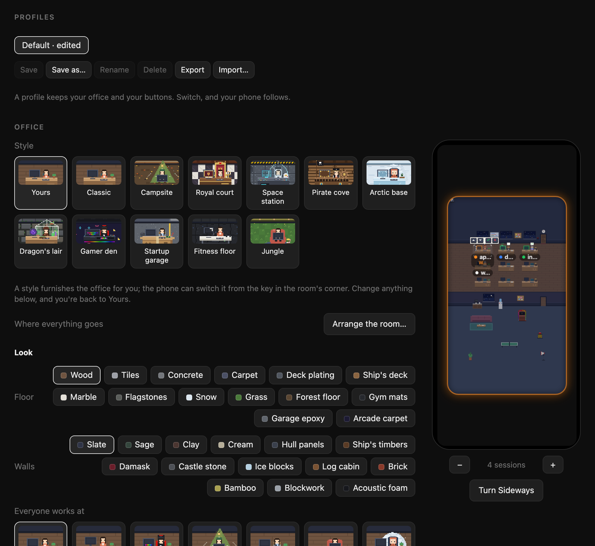

# The office, your way

Desks, profiles, buttons, and everything about the office: its floors, styles, outfits and how to arrange the room. Back to the [README](../README.md).

## Make it yours

The setup page also has:

- **Desks.** There is one desk for each running session. Drag a running
  session onto a desk to keep that project there; desks you don't pin go to
  the next session that starts.
- **Profiles.** Save your office and your buttons under a name, and switch
  between them in a click: one for the couch, one for the desk. Default is
  always the standard office. Export a profile to back it up or share it.
  Before an imported profile is added, the setup page lists everything its
  buttons would type or press.
- **Office.** Its style, [arranging the room](#the-office), its look and its
  life, your team, the dress code, and **Your buttons**: each types a command,
  such as `/compact`, or presses a key, such as Shift+Tab to switch Claude
  Code's mode, from the keys a held desk brings out. A button can wait until
  the agent isn't busy, ask for a second tap, or be for some agents only. A
  live preview of your phone sits beside it.
- **Logo.** The Smolcorp hire or the original six keys, in the menu bar, on the
  setup page and on your phone's Home Screen. A phone picks up a new logo the
  next time you add the deck to its Home Screen.
- **More:** [Tell other tools](extras.md#tell-other-tools), for sending what your agents
  do to Home Assistant or another tool of yours.

  

Open the setup page any time from the menu bar (**Settings…** on a Mac, **Open
Setup…** in the tray on Windows and Linux), or by opening Smolcorp again from
Applications. A bookmark of the page won't open it: the menu opens it with a
link that works once, for five minutes.

On a Mac, the office's corner key is **⚙︎ Settings**, and setup's General →
Window has **Keep the office on top of other windows** and, below it,
**Shortcut to show and hide the office**, ⌥⌘O until you change it: click it and press the
keys you want, with ⌘, ⌥ or ⌃. It works at once, from any app, and needs no
permission. **Reset to default** brings back ⌥⌘O and **Off** turns it off.
The keys are shown as your keyboard prints them: on a French AZERTY Mac, ⌥⌘A
is ⌥⌘A. Smolcorp won't take the Mac's own keys, by what they type on your
keyboard: ⌘Tab, ⌘Space, ⌘Q, ⇧⌘Q, ⌃⌘Q, ⌘W, ⌘H, ⌘M, ⌘, and the editing and file
keys every app has (⌘C, ⌘V, ⌘X, ⌘Z, ⇧⌘Z, ⌘A, ⌘S, ⌘F, ⌘T, ⌘N, ⌘P, ⌘O). It also
won't take keys macOS has switched on in Keyboard Shortcuts, or keys macOS
won't let it hold. It can't see other apps' own shortcuts, so keys with ⌘ and
neither ⌥ nor ⌃ get a warning: an app of yours may use them, and it won't get
them while Smolcorp holds them. If the keys you chose can't be held any more,
the setting says so. A test copy holds no shortcut at all, and says so; it
never brings its office forward. On Windows and Linux the setting is kept but does
nothing: use **Show Office** in the tray. **Let features press
keys in other apps** (Mac) is off until you turn it on and name the apps it may
use.

## The office

  

Your sessions are people in a little pixel-art office. Each session is a
desk, numbered as on the setup page, and the person at it acts out what their
session is doing:

| Session | In the office |
|---|---|
| Working | Typing, the screen lit, dots rising from it |
| Waiting on you | Standing up and waving, with a blinking **!**. Kept waiting more than five minutes, they get agitated: hopping, a red **!**, steam from the ears |
| Done, unread | Leaning back with a coffee and a ✓ |
| Idle | Off to the coffee machine, the window, the water cooler, the couch or a game of ping-pong |
| Error | Head in hands, smoke from the screen. A rate limit has them waiting under the clock instead. |
| A new session, an ended one | Someone walks in through the door, or out of it |

There's more to see while they work:

- **Under each desk**, the project's name and what its agent is doing, such as
  *Editing Settings.swift* or *Waiting for you: Bash*.
- **On the monitor**, how long the turn has run. After ten minutes, the agent
  starts to sweat.
- **What they're working with.** Reading files, they leaf through papers; a
  command turns the screen terminal-green; the web spins a globe on the desk;
  a to-do list sends them to the whiteboard. Compacting the conversation, they
  feed it into a shredder.
- **Interns**, one for each of Claude Code's subagents, gather round the desk
  while they work: up to four, then a "+n".
- **What they wear** is the size of their model, the bigger the smarter: small
  models such as Haiku, GPT mini or Gemini Flash-Lite dress casual, in a
  T-shirt and jeans; medium ones such as Sonnet wear a shirt; large ones such
  as Opus or Gemini Pro a jacket; and the top ones, such as Fable, a suit and
  tie. Interns dress for their own model. While an agent's model isn't known,
  as for most agents but Claude Code, it wears its agent's colour.
- **Coffee at the desk** is Claude Code's effort: a stack of mugs by the
  monitor, one for low up to four, swaying, for extra high, and at max a
  steaming moka pot, with steam coming off the agent. Press ☢ Max, and the
  agent runs to the big red button in the corridor and slams it.
- When few sessions are running, the office's own staff hang around the lounge.

**Furnish it your way** under *Office* on the setup page:

- **A style** furnishes the whole office in one go: Classic, Campsite, Royal
  court, Space station, Pirate cove, Arctic base, Dragon's lair, Gamer den,
  Startup garage, Fitness floor, Jungle, Neon city, Submarine, Lo-fi café, Wild
  West saloon, Zen garden or Treehouse. Most bring a pet of their own: a
  fox at the Campsite, a corgi at the Royal court, a robot dog on the Space
  station, a parrot in the Pirate cove, a penguin at the Arctic base, an owl in
  the Dragon's lair, a hamster in a ball in the Gamer den, a monkey in the
  Jungle, a hover drone in Neon city, a cat in the Submarine and the Lo-fi café,
  a tumbleweed in the saloon, a snail in the Zen garden and a red panda in the
  Treehouse. Switch it from your phone too: tap the key in the room's top-left
  corner and pick one. **Yours** is the office as you furnish it below, and
  changing anything there but the pets takes you back to it. Your team, the
  daylight, the seasons and the sound stay as you set them, and so do the pets
  you pick, in place of the style's own. Four styles also put the whole office
  in costume, with nine outfits each: the Castle great hall (a royal court),
  Mount Olympus (the Greek gods), the Zoo (animal onesies) and the Ant colony.
  You can pick any of those outfits for someone on your team, too.
- **The floor** in wood, tiles, concrete or carpet, and more, and **the walls**
  in slate, sage, clay or cream, and more.
- **In the room editor** (below): the mic you talk into, from a microphone to a
  megaphone, what hangs on the back wall, a window, a whiteboard, a pinboard,
  a poster and dozens more, with the to-do lists going up on the first
  whiteboard, the lounge's own floor and wall, and its corner piece, one of
  the lounge's pieces, each picked from its picture: an arcade
  machine, a vending machine, a foosball table, a fish tank, a bookcase and a
  beanbag, a dragon asleep on its gold, pinball, a jukebox, a pool table, a
  piano, a drum kit, a telescope, jellyfish, a bonsai, a jungle, a coffee bar,
  servers, a 3D printer, a punching bag, a treadmill, a hot tub, a ball pit or a
  campfire. Idle agents and staff go and play, grab a snack, or sit by the fire,
  and the pets join in.
- **Where everyone works:** at a desk, or a standing desk, a gaming desk, a
  tent, a cardboard box, a beanbag, an igloo, a camper van, a spaceship, a
  pirate ship, a throne or a greenhouse. Each project can have its own on its
  team card, and it goes with them when they swap desks.
- **Daylight** that follows the clock, with night falling at 8 pm, or always day.
- **Seasons in the windows:** snow in winter, with lights strung along the wall
  through December, falling leaves in autumn, blossom in spring, birds in summer.
- **Up to three pets:** a cat that naps on the couch, a dog that follows
  people about, a lizard that basks on the wall, a monkey that climbs on things
  and steals cups, or a llama, a penguin, a parrot, an owl, a capybara, a red
  panda, a corgi, a hamster in a ball, a robot dog, a bat, a snail, a fox, an
  axolotl, a black cat, a goat, a raven, a little ghost, a spider on a thread, a
  reindeer, a little snowman, a snow hare, a little cupid, lovebirds, a hover
  drone or a tumbleweed. Pick them in any style, and they take the place of its
  own.
- **In the air:** nothing, snow, floating hearts, a dragon dance or confetti,
  and **in the windows**, fireworks at night.
- **The seasons' pieces**, each its own choice in the room editor: Halloween,
  Christmas, winter, Saint Valentine, Lunar New Year, New Year's Eve and a
  sport season, a basketball court and a broadcast set, with outfits to match.
- **Sound:** off, quiet or normal, in the style of an old games console, and
  mostly silence: a burst of typing as an agent gets to work, the door, the
  coffee machine, a ping-pong rally, the red button's siren, a hire, a firing,
  the pets, the wind in winter, and now and then the lounge's piece while
  someone's at it. The one sound that asks for you is the reminder after five
  minutes of waiting. It starts with your first tap, as browsers require.
  Under it, softly, real keyboards while agents work, each at its own pace, and
  a muffled chat at a desk while a message is taken there; turn that off under
  *Typing and chatter*. The recordings are public domain (CC0), from Freesound.
- **The desks** in wood, walnut, white or black, and **the chairs** in teal,
  black, red, grey or green.
- **Office staff:** a few, none, or lots of them in the lounge.
- **A calm office**, under *Life*: nobody wanders off, the staff and pets stay
  put and nothing drifts by the windows, so the office moves only for the work,
  and draws less often, for less power. Agents still work, type, come and go.
- **A lite office on your phone**, on by default: it goes as a calm office
  does, at 30 frames a second, so the phone stays cool. It's that phone's own
  choice, and changes nothing on your other screens. To turn it off, tap the
  paint roller in the room's corner, then the switch at the foot of *Office
  style*.
- **A jukebox that plays your music**, once you turn it on under *Getting
  started*: tap any jukebox in the office to play or pause whatever this
  computer is playing, Spotify, Apple Music or a video in your browser. It
  lights up while Spotify or Apple Music plays; macOS asks once whether
  Smolcorp may ask them. Hold a jukebox for its controls: back, play or
  pause, next, and a bar for this computer's volume.

**Arrange the room** puts everything where you want it. Click **Arrange the
room…** under *Office*, and the office fills the window: click a piece to pick
it and drag it anywhere, or nudge it with the arrow keys. The lounge's pieces,
the couch, the ping-pong table, the plant, the coffee counter, the red button
and the mic grow by the handle on their corner: small, medium or large. Pick a
desk to make it what you like, a tent, a beanbag or a cardboard box, whoever
sits at it; a project's own choice on its team card still comes first.

**The drawer** beside the room holds whatever isn't in it: desks and furniture
put away, any piece the lounge can hold, up to twelve and the same one more
than once, and everything the back wall can hang, up to twelve, wherever you
slide them along it. Drag a piece into the room, or click it to put it where
it fits. To put one away, drag it onto the trash that shows below the room
while you carry it, or back to the drawer. A session whose
desk is put away waits in line along the back wall. **Start empty** leaves the
floor, the walls, the door, the mic and the red button; **Back to standard**
puts everything back; **Undo** and **Redo** (⌘Z, ⇧⌘Z) step through your
changes. The room on its side and upright are arranged on their own, and
**Copy from upright** or **Copy from sideways** starts one from the other.
Pick a floor at the top to arrange it instead: each floor upstairs keeps its
own arrangement, its desks, its furniture and its chill area, in the style
the floor has. The red button and the mic stay on the ground floor, and the
door and the elevator are where they are downstairs.
People walk round whatever is in their way, and a desk nobody can get to from
the door is outlined in red. Your phone follows as you go.

**Your team**, under the furnishing, has a card for each of your projects:
choose its agent's skin, hair and hairstyle, something extra (glasses,
sunglasses, headphones, a cap, a beanie, a beard, a moustache or a bow), an
outfit and its colour, what's on their desk, where they work, and a nickname
for their desk's label. Anything left on Auto stays as the office picks it, and clothes on Auto
follow the model.

**The dress code**, under the team, chooses the outfit and colour for each size
of model, and for each agent while its model isn't known. Add your own rules
for models the office doesn't know, such as "a model whose name contains
`qwen-max` is large". Thirteen outfits to choose from, there and on the team
cards, from a T-shirt to a lab coat, overalls or a Hawaiian shirt.

It's all kept with the layout, so each profile can have an office of its own.

**On your phone**, the office is the deck: see [On your phone](phone.md#on-your-phone).
Two more things work there:

| In the office | What it does |
|---|---|
| An agent's desk, held, then dragged | Picks the agent up, chair and all. Let go over another desk and the two swap. They stay that way: each project is pinned to its new desk, as on the setup page's *Desks*, where you can undo it. |
| A desk, held | With hiring and firing on, also **YOU'RE FIRED**, or the roles to hire on any free desk (see below). |

**Hire and fire**, once you turn on **Let the office hire and fire** on the
setup page (it's off until you do):

- **Hold an agent's desk**, and a red **YOU'RE FIRED** comes out above its
  chips. Tap it, confirm, and its work stops and its Terminal tab closes. The
  agent packs a box and walks out. Claude Code keeps the conversation, so
  `claude --resume` can bring it back.
- **Hold any free desk**, and the roles come out along the foot of the room:
  **Anyone**, then each role with its badge. Tap one, and a new Terminal
  window opens in the folder you chose on the setup page. Anyone is a regular hire, with the agent you chose; a role
  starts its own agent, at its model and effort, on its instructions. The new
  hire walks in through the door with a coffee or a box, and sits at the desk
  you held. It stays there after a refresh, `/clear` and a restart; a desk
  that's taken can't be hired onto. On a pinned project's empty desk, the hire
  starts in that project instead.
- **Comings and goings**, on the setup page: as above, with the coffee, the box
  and the packing up, or **Plain**, where people just walk in and out.

**Hire by role.** A role is a name, an agent, a model, an effort, a badge and
instructions, set under *Roles* on the setup page. Nineteen come with
Smolcorp, each reporting what it finds and asking before it changes anything:

- **Reviewer** (glasses and a red pen): reviews the changes you point it to,
  most serious problems first.
- **Tester** (a clipboard): runs the tests you pick and explains each failure.
- **Bug hunter** (a magnifying glass, dressed as a detective): looks for bugs
  where you point it, with how to reproduce each one.
- **Docs writer** (a quill and notebook, dressed as a librarian): checks the
  docs you pick against the code.
- **Refactorer** (a wrench, in a hard hat): proposes one refactor at a time,
  within the limits you give.
- And fourteen more, each dressed for the job: an **Art Director**, a
  **Lawyer** (who says it isn't legal advice), a **Therapist** for when you're
  stuck, a **Plumber** for pipelines, a **General Manager** to run a team of
  agents (see [Run a team](team.md#run-a-team)), a **Janitor** for clean-ups, a
  **Firefighter** for outages, a **Pilot** for releases, a **Postman** for
  notifications and webhooks, an **Accountant**, a **Marketer**, a **Security
  guard**, a **Chef** for scaffolds and prototypes, and a **Thinker**, who
  thinks a question through and writes it up.

Setup's brief library also has briefs to start a role of your own from: a
**Builder**, a **Designer**, a **Pixel artist**, a **Planner**, a **Fixer**, a
**Study**, and **Security** and **Performance auditors**. On the Mac, each role
starts from its brief, written into its folder; on Windows and Linux, from its
instructions.

New roles that come with an update are added once, at the end of yours; one
you've deleted isn't brought back. Change any of them, put them in your order,
or add as many of your own as you like.
A role never assumes what to work on. Its first reply only asks you, all
together, which project to work on (at a pinned project's desk, whether it's
that one) and its own questions, such as the Reviewer's branch, base and what
matters most. It's told to read nothing and run nothing until you've
answered, then it gets to work. Each role's questions are yours to change, one per line. Its desk shows the role,
as in *Reviewer · api-server*, and its badge, and it keeps the role after
`/clear`. Roles stay on your computer, out of profiles: the phone only knows
their names and badges.

On Windows and Linux, firing closes the agent's pane in tmux, kitty and
WezTerm, and stops an agent started with `smolcorp run`. A hire opens a window
of the terminal you choose on the setup page (GNOME Terminal, Konsole, kitty,
WezTerm and others on Linux; Windows Terminal or a console window on Windows),
running the agent through `smolcorp run`, so its keys work from the phone. On
Linux it can run in a tmux session of its own instead; on a computer with no
desktop, as over SSH, it always does, for `tmux attach` to show it.
`smolcorp run --role tester`, in the folder to work in, also starts a role from
any terminal, and its desk shows the role.

**Held upright,** the room stands upright too: the lounge moves below the
desks, through a doorway at the end of the corridor.

**On a spare screen**, such as an old tablet, a TV or a second monitor, open the
address your phone uses with `/office` at the end. It pairs like a phone, then
shows the office alone, full screen, and can be tapped too.

**On top of your other windows:** on the computer running Smolcorp, open
`http://localhost:7710/office` in Chrome or Edge and click **POP OUT** in its
corner. The office moves into a small window that stays above everything else,
and can still be clicked. Other browsers, and the address your phone uses,
don't offer it.

**As your Mac's screen saver:** click the Smolcorp icon in the menu bar
and choose **Install Screen Saver…**. System Settings opens at Screen Saver:
choose **Smolcorp Office**, click **Options…**, and enter a code from
**Pair a Phone…**. It's listed under Paired phones as **Screen saver**. While
your Mac is idle, each display shows the office, just to watch: a key or a click
ends the screen saver as usual. When Smolcorp isn't running, or the screen
saver was unpaired, it says what to do instead. After updating Smolcorp,
choose **Install Screen Saver…** again.

On your phone, on a spare screen and in the pop-out window, the office fills a
rounded window; the screen saver fills each display edge to edge. Either way,
its edge glows while an agent is waiting on you.
