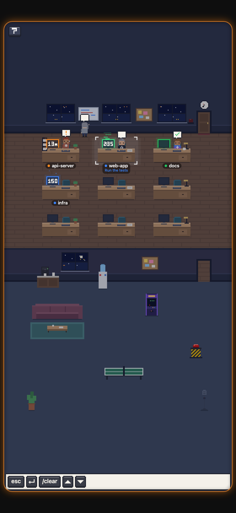
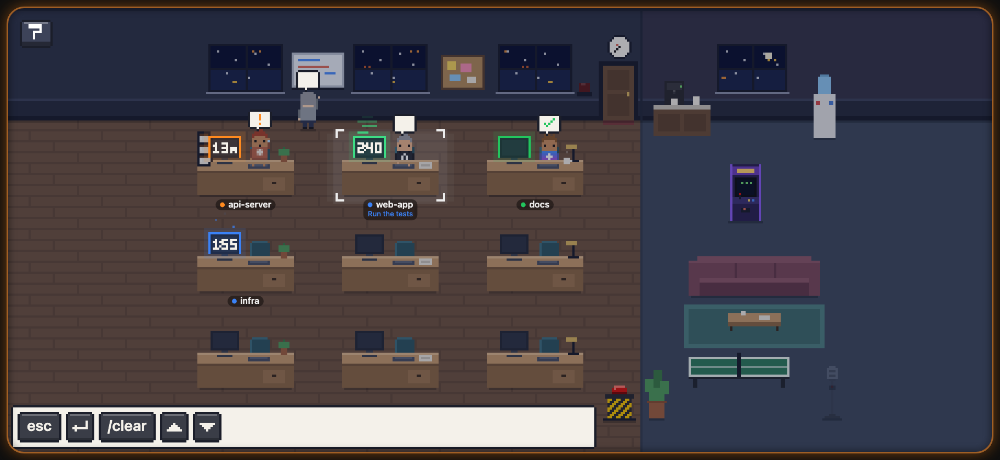

# Smolcorp on your phone

The office in your phone's browser: what each tap does, pairing, voice, and typing to your agents. Back to the [README](../README.md).

<p align="center">
  
</p>

There's no app to install. The office opens in your phone's browser, over
your Wi-Fi, or from anywhere with [Tailscale](https://tailscale.com), and the
AI coding agents in your terminal (Claude Code, Codex, Gemini CLI, OpenCode
and Grok) are the people in it.

Each agent session sits at a desk in [the little pixel-art office](office.md#the-office),
acting out what it's doing. From the office you can
approve a permission request from across the room, interrupt an agent, change
how hard Claude Code thinks, press buttons of your own, or hold the mic and talk to
it. Smolcorp runs in
your Mac's menu bar, or in the tray on [Windows and Linux](windows-linux.md#windows-and-linux).

<p align="center">
  
</p>

## On your phone

The phone opens straight into the office, full screen, upright or sideways as
you hold it. Each desk is one of your agent sessions, named after its project:
the folder the agent started in, or the top of its git repository.

| In the office | What it does |
|---|---|
| **A desk, or its person** | Picks that session and brings its Terminal window to the front. |
| **▲ ▼ ✓ ✕ over the picked agent, when it's waiting on you** | Move through its options, accept or reject. They come up on their own. |
| **A desk, held** | Brings out its keys along the foot of the room: **esc** interrupts it, **⏎ send** presses Return, **/clear** starts a fresh conversation (tap twice), **↑ ↓** move through its menus, then [your own buttons](office.md#make-it-yours). On a Claude Code desk, also paint chips for its thinking effort, from low to max; if Claude is mid-task, the change waits until it finishes. The coffee by the monitor shows the effort: one mug for low, up to four, and a steaming pot at max. A tap elsewhere puts them away. |
| **The red button** | ☢ Max effort for the picked session, in one press. |
| **The mic, held** | Talk to Claude Code. Let go, and Claude sends what you said once it's three words or more. |
| **Two fingers, dragged** | Scroll the picked session's Terminal window; tap with two to jump back to the bottom. Off until you turn on **Let two fingers scroll Terminal** on the setup page. |

How the people show what their sessions are doing is under
[The office](office.md#the-office). The room's edge glows while an agent is waiting on
you.

Sessions keep their order at the desks, and each keeps its own until it ends.
You can pin projects to specific desks and furnish the office your way.

## Pair your phone

1. On your computer, click the Smolcorp icon in the menu bar or tray and
   choose **Pair a Phone…**. The setup page opens with a six-digit code and a
   QR code.
2. Scan the QR code with your phone's camera. The key it hands your phone
   is after `#` in its link, a part a browser never sends, so it never crosses
   your Wi-Fi, and your phone adds a part of its own as it pairs. That part
   does cross the Wi-Fi as your phone pairs, unencrypted: a photo of the QR
   code alone, without also watching your Wi-Fi as your phone pairs, isn't
   your phone's key, but the two together are. And until your phone has
   scanned it, a photo could pair another phone: keep it to yourself, and if
   your phone says the code isn't valid, check **Paired phones** in setup. Typing
   the code instead (open the address shown with it, for example
   `192.168.1.20:7710`) works over Tailscale only: over plain Wi-Fi it's
   refused, since the answer would carry your phone's key unencrypted.
3. Add the deck to your Home Screen: on an iPhone, tap **Share → Add to Home
   Screen**; on Android, open the browser's menu and tap **Add to Home
   screen**. Smolcorp now opens full screen and stays paired.

### Wi-Fi or Tailscale

**Use the Tailscale link when you can.** Tailscale encrypts everything between
your phone and your computer. Plain Wi-Fi doesn't: the deck is plain http
there, so anyone on the same Wi-Fi can read what it shows and what you type.
Your phone's key never travels: each request is signed with it, names its
time, and works once, so a request someone captured can't be sent again.
Someone who can tamper with the Wi-Fi's traffic, not just read it, could still
change the page itself, which only Tailscale prevents.

**Typing over Wi-Fi** is off for a new setup: the deck's keys work over the
Wi-Fi, but text typed or dictated from the phone goes only over Tailscale.
Turn it on under **Paired phones** in setup if you need it, and off again if
you don't. A setup from before this switch keeps typing over Wi-Fi as it did,
and setup shows the warning beside the switch.

A phone paired before 1.25 sent its key unencrypted over the Wi-Fi, and a
page saved then (its address ends in `?t=` and a long key) still does, so its
key no longer works over the Wi-Fi at all, signed or not. Setup lists it as
paired before 1.25: unpair it, since its key may have been read, then pair it
again with the QR code and add the new page to your Home Screen. Once it has,
setup offers to remove the old entry. Over Tailscale, and on this computer,
the old key still works.

Tailscale is told apart by where a request comes from. A reverse proxy on
the same computer (Caddy, nginx and the like) that hands requests from your
Wi-Fi on to Smolcorp makes them look as if they came through Tailscale:
don't put one in front of Smolcorp, other than `tailscale serve`.

While the deck is open, your phone's screen stays on, from your first tap. If
an agent has been waiting on you for five minutes, the deck reminds you once,
with a chime, and a buzz on phones that allow it.

Each phone you pair appears under **Paired phones** on the setup page, with
when it was last used. **Revoke** cuts one phone off straight away;
**Unpair All Phones** does it for every phone, and is also in Smolcorp's
menu. A phone you've cut off shows the pairing page again. To use it once
more, pair it with a new code, then remove the old Home Screen icon and add
the deck again: the icon keeps the old pairing.

<p align="center">
  
</p>

## Voice

The mic button uses Claude Code's own voice input (`/voice`), in *tap* mode.
Connecting Claude Code sets that up, unless you had already set voice up
yourself. In that case, make sure `~/.claude/settings.json` contains:

```json
"voice": { "enabled": true, "mode": "tap" }
```

Voice input needs Claude Code signed in with a Claude.ai account. Claude Code
sends your audio to Anthropic to be transcribed. Smolcorp itself never
hears it.

**Clean up dictation with Claude** (Mac, setup → Phone and voice; off until
you turn it on): with the Mac's own dictation on, the dictated *text*, never
the audio, goes to Claude Haiku before it's typed, with
[your own API key](extras.md#summaries-with-claude): fillers and stutters go, and
misheard names come back as the glossary beside it spells them. If that
fails, there's no key, or it takes over 2.5 s, the text goes in as heard.

## Typing from the phone

**⚙︎ → Type to …** types into the picked agent, on the Mac, Windows and
Linux, over Tailscale, or your Wi-Fi with **Typing over Wi-Fi** on
([off for a new setup](#wi-fi-or-tailscale)). Over the Wi-Fi, what you type isn't
encrypted, and the deck says so: Tailscale is the private option. It's on
unless you turn it off: on the Mac with setup's **Phone microphone** switch
(Phone and voice); on Windows and Linux, which have no switch in setup yet,
with `"phoneMicEnabled": false` in `config.json`.

What you type goes to the agent as text, with Return pressed on its own once
it's in. Nothing is typed to an agent that's asking you something (that's
checked again right before the words go in), text starting with `!` is
refused, since Claude Code would run it as a shell command, and 2,000
characters is the most at a time.

Several lines go in as one paste, never with a Return part way through:

- **In tmux**, when the agent asked for it, and **in a window of Smolcorp's
  launcher** on Windows and Linux, the same way.
- **On a Mac, in Terminal, iTerm2 and Ghostty**, through the clipboard and
  ⌘V, for Claude Code only, waiting at its prompt with nothing else open in its
  tab. Terminal and iTerm2 come to the front for it, and it never happens
  while the Mac is locked or in use. Afterwards your clipboard is put back,
  except a password you'd copied, which is cleared, not put back. **A
  clipboard manager, or iTerm2's paste history, may keep a copy of text sent
  this way.**
- **Anywhere else**, such as WezTerm and kitty, or another agent in Terminal,
  it's one line at a time: several lines are refused with a sentence saying
  so, and nothing is typed.

Left in `!` mode or with a menu open at the Mac (/resume, /model, Ctrl-R),
Claude Code looks idle, so Smolcorp still reads it as waiting: several lines
go to that mode or menu, and Return runs them or picks the highlighted item.

## The phone's own mic (Mac, over Tailscale)

With **Phone microphone** on, the phone can do the listening itself. Browsers
give a page the mic only over HTTPS, so open the deck through Tailscale: setup's
**Use from anywhere** gives the `tailscale serve` line to run on your Mac, and
a QR code that pairs your phone at that address. Then hold the mic and speak:
the phone recognises your words, and only the text reaches your Mac. Nothing
is kept. On an iPhone, Apple does the recognising, and may send your voice to
Apple for it.

Let go, and the phone shows what it heard: **Send** it, **Type only** (it's
typed, and you press Return when you're ready), or cancel. Setup can send it
by itself instead, when it's three words or more. Once it's typed, the phone
shows the last lines of that agent's terminal (over Tailscale only). It's
typed by the same rules as [Typing from the phone](#typing-from-the-phone).

Over plain http on your Wi-Fi, holding the mic uses the Mac's mic, as above.
On Windows and Linux, the phone's own mic isn't offered.

## HTTPS through tailscale serve (Mac and Linux)

Over HTTPS, the deck opens at this computer's `ts.net` name from anywhere your
phone is signed in to Tailscale, and the phone's own mic works. Setup's **Use
from anywhere** says where Tailscale stands, and **Turn it on…** runs the one
line Smolcorp needs, after showing you exactly what it runs and what it opens to
your tailnet. Only your own devices reach it, and a phone still needs a pairing
code. Don't use Funnel: that puts the deck on the public internet.

`tailscale serve` hands the deck on through a private socket, `serve.sock`, in
Smolcorp's folder, never through its port. Smolcorp checks that what connects
there really is Tailscale, and anything that arrives over the port with
Tailscale's headers counts as just another program on your computer.

- **On the Mac,** use Tailscale from tailscale.com. The Mac App Store version
  runs as you, so Smolcorp can't tell it apart from any other program on your
  Mac, and refuses what it hands on. The line is
  `tailscale serve --bg --https=443 unix:<Smolcorp's folder>/serve.sock`, and
  setup shows it in full.
- **On Linux,** Smolcorp takes what connects to the socket as root, as
  tailscaled runs. Any program running as root could do the same, as it can do
  anything else on your computer. Changing what Tailscale serves takes root
  too, so setup shows the line with `sudo` in front:
  `sudo tailscale serve --bg --https=443 unix:<Smolcorp's folder>/serve.sock`.
  If **Turn it on…** says Tailscale didn't do it, run that line in a terminal:
  it asks for your password, then does that one thing. Setup also mentions
  making yourself Tailscale's operator (`sudo tailscale set --operator=$USER`)
  so the button works without sudo, but only as an option: every program you run
  could then change Tailscale's settings (serve, funnel and the rest), not
  only Smolcorp.
- **On Windows,** Smolcorp still refuses what `tailscale serve` hands on.
  Open the deck at this computer's own Tailscale address instead.
- **After updating to 1.26,** if HTTPS through `tailscale serve` was on before,
  turn it on again, once: it pointed at the port, which no longer counts.
  Setup says so, and **Turn it on…** does it. On Linux, unless you're
  Tailscale's operator, run the `sudo` line above instead.
- **To stop it,** run `tailscale serve --https=443 off` (with `sudo` on Linux),
  or tap **Turn it off…**.

### If the phone shows 502 Bad Gateway

A 502 means Tailscale reached your computer, but Smolcorp didn't take what it
handed on. Setup may still say it's on, since it reads Tailscale's settings. It
is one of three things:

1. **Smolcorp couldn't open `serve.sock` as it started.** Quit Smolcorp and
   open it again.
2. **Smolcorp refused who connected.** On the Mac, that's Tailscale from the
   Mac App Store: install it from tailscale.com, then tap **Turn it on…** again.
   On Linux, it's a tailscaled that doesn't run as root, one in a container, or
   a `/proc` mounted with `hidepid`, which hides tailscaled from Smolcorp. Run
   tailscaled as root, as Tailscale's own packages do, with `/proc` as it comes.
3. **Tailscale can't reach the socket in Smolcorp's folder.** On Linux, a
   tailscaled kept out of your home folder (a systemd unit with
   `ProtectHome=`, or the snap) can't. Turn HTTPS through `tailscale serve`
   off, and open the deck at this computer's Tailscale address meanwhile.

Each of these fails closed: the phone gets nothing, and nothing else gets in.
